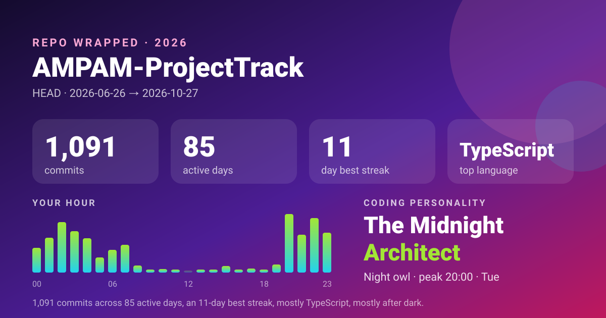

# repo-wrapped

Spotify Wrapped for any git repository: your streaks, hours, files, habits and coding personality, offline, from one `git log`.

[](https://github.com/ahmad-punch/repo-wrapped/actions/workflows/ci.yml)
[](LICENSE)
[](package.json)
[](tsconfig.json)

## Demo

A real run on [InterviewsInAIEra](https://github.com/ahmad-punch/InterviewsInAIEra), a small TypeScript project, excerpted. It took well under a second.

```text
$ repo-wrapped ~/code/InterviewAI --author Ahmad
╭─ REPO WRAPPED 2026 ──────────────────────────────────────────╮
│                                                              │
│ InterviewAI                                                  │
│ branch HEAD · commits by Ahmad                               │
│                                                              │
│        47  commits                                           │
│         4  active days                                       │
│       638  files touched                                     │
│   +36,459  lines added                                       │
│      -655  lines deleted                                     │
│                                                              │
│ First commit  2026-10-04                                     │
│ Last commit   2026-10-21                                     │
│                                                              │
╰──────────────────────────────────────────────────────────────╯

╭─ STREAKS ────────────────────────────────────────────────────╮
│                                                              │
│ Longest streak                                               │
│ 1 day in a row  2026-10-04 → 2026-10-04                      │
│                                                              │
│ Longest break                                                │
│ 7 days off  2026-10-04 → 2026-10-12                          │
│                                                              │
│ Force-of-nature day                                          │
│ 33 commits on 2026-10-14                                     │
│                                                              │
│ Merges 0  ·  Reverts 0                                       │
│                                                              │
╰──────────────────────────────────────────────────────────────╯

╭─ YOUR HOUR ──────────────────────────────────────────────────╮
│                                                              │
│ ················▅▅▅▅██▃▃▁▁······▁▁··············             │
│ 00          06          12          18        23             │
│                                                              │
│ Mon  ██                                                  2   │
│ Tue                                                      0   │
│ Wed  ████████████████████████████████████████████████   42   │
│ Thu                                                      0   │
│ Fri                                                      0   │
│ Sat                                                      0   │
│ Sun  ███                                                 3   │
│                                                              │
│ Early bird  peak 10:00 · Wed                                 │
│ 23% of your commits landed between 05:00 and 09:00.          │
│                                                              │
╰──────────────────────────────────────────────────────────────╯
```

Full output continues with top files, biggest commits, co-authors and a closing one-liner. The same run exported as a share card with `--svg`:



## Why

Year-end recaps exist for music, but not for the place many of us spend more hours. Hosted dashboards need a token and only see what was pushed. `repo-wrapped` runs locally against any clone, including private and unpushed work, reads nothing but `git log`, and sends nothing anywhere.

## Install

Requires Node 22+ and git.

```sh
git clone https://github.com/ahmad-punch/repo-wrapped.git
cd repo-wrapped
pnpm install
pnpm build
node dist/cli.js --all-authors      # wrap this repo
pnpm link --global                  # optional: puts `repo-wrapped` on your PATH
```

## Usage

```sh
repo-wrapped                         # current repo, your commits (git config user.email)
repo-wrapped ~/code/app --year 2026  # one calendar year
repo-wrapped --all-authors --top 10  # everyone, with a leaderboard and bus factor
repo-wrapped --author "Ada" --since "6 months ago" --branch main
repo-wrapped --json > stats.json     # raw numbers for your own charts
repo-wrapped --svg wrapped.svg       # shareable 1200x630 card
repo-wrapped --md wrapped.md         # Markdown summary (omit the file to print it)
```

| Flag | What it does |
| --- | --- |
| `[path]` | Repository to read. Defaults to the current directory. |
| `--since`, `--until` | Date range, in any format git accepts (`2026-01-01`, `"3 months ago"`). |
| `--year <yyyy>` | Shortcut for a single calendar year. |
| `--author <pattern>` | Author name or email pattern. Defaults to your `user.email` for this repo. |
| `--all-authors` | Include everyone, and add the leaderboard and bus-factor estimate. |
| `--branch <name>` | Branch or revision to read. Defaults to `HEAD`. |
| `--top <n>` | Length of each top list (1 to 100, default 5). |
| `--json` | Print the full stats object instead of cards. |
| `--svg <file>` | Write the share card. |
| `--md [file]` | Write or print a Markdown summary. |
| `--no-color` | Plain output. `NO_COLOR` and non-TTY output turn colour off too. |

What you get: commits, active days, longest streak and longest break, busiest day, merges and reverts; hour and weekday histograms with a persona (night owl, early bird, 9-to-5er, weekend warrior); top files, directories and languages; biggest and smallest commits and your additions-to-deletions ratio; average subject length, top words minus stop-words, share of conventional commits, wip/typo/oops confessions and emoji use; `Co-authored-by` pairing; and a final one-line summary with a deterministic personality label.

## How it works

1. `git log --numstat` is spawned without a shell, with each commit framed by ASCII record and unit separators so multi-line messages never collide with file stats.
2. Output is parsed as it streams and folded into a collector that keeps only running tallies, so memory stays flat on long histories.
3. The finished stats object drives three renderers: box-drawn terminal cards (picocolors), a self-contained SVG using system fonts, and Markdown. `--json` prints the object itself.

Hours use each commit's own author timezone, so a 23:00 commit in Karachi and one in Berlin both count as late night. Lock files, `dist/`, minified and generated files are left out of the language and file rankings. More detail in [docs/DESIGN.md](docs/DESIGN.md).

## Roadmap

- `--compare <year>` to show this year against last year side by side.
- A `--mailmap`-style alias file for merging authors who commit under several names.
- A PNG export alongside the SVG card for platforms that do not render SVG.

## Contributing

Issues and pull requests are welcome; see [CONTRIBUTING.md](CONTRIBUTING.md). `pnpm test` builds a throwaway fixture repo with fixed dates, so tests are deterministic.

## License

[MIT](LICENSE) © 2026 Ahmad Salman Khan
